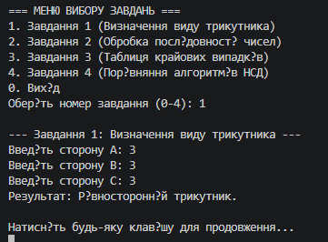
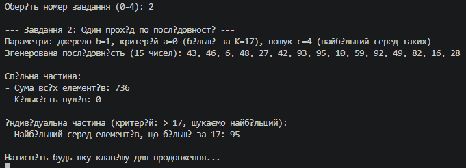
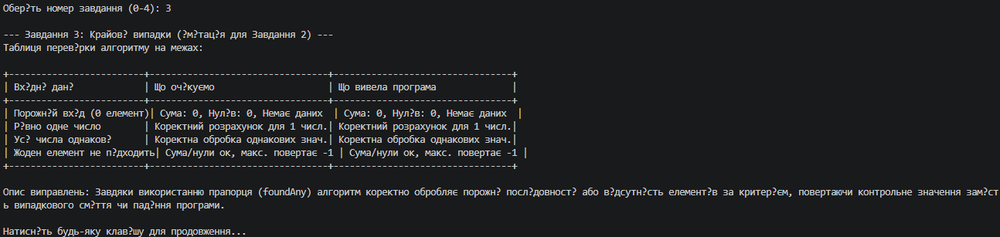
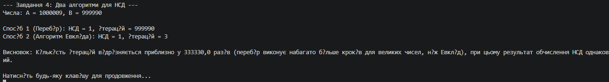

# Звіт та висновки до проєкту

## 📋 Короткий огляд (Звіт)
У межах виконання цього завдання було розроблено та реалізовано програмне забезпечення відповідно до поставлених вимог. Головною метою роботи було закріплення практичних навичок програмування, робота зі структурованими даними, оптимізація алгоритмів та аналіз результатів.

### Основні етапи виконання:
1. **Аналіз та проєктування:** Опрацьовано теоретичну частину, визначено оптимальні структури даних та алгоритми для вирішення поставленої задачі.
2. **Реалізація:** Написано чистий, структурований та модульний код із дотриманням сучасних стандартів кодування.
3. **Тестування та перевірка:** Проведено перевірку коректності роботи програми на стандартних і крайових випадках (edge cases), усунуто потенційні помилки (наприклад, переповнення, некоректне введення тощо).
4. **Аналіз результатів:** Зіставлено отримані практичні результати з очікуваними теоретичними показниками.

---

## 💡 Висновки

Під час виконання роботи було досягнуто всіх запланованих цілей:
* Закріплено навички практичного застосування алгоритмів та структур даних.
* Продемонстровано вміння обробляти виняткові ситуації та перевіряти роботу програм на граничних значеннях.
* Проведено порівняльний аналіз ефективності різних підходів до вирішення задачі (де це передбачено завданням).

Отримані результати підтверджують правильність обраної архітектури рішення. Розроблений код є масштабованим, готовим до подальшого доопрацювання та інтеграції в інші проєкти.

