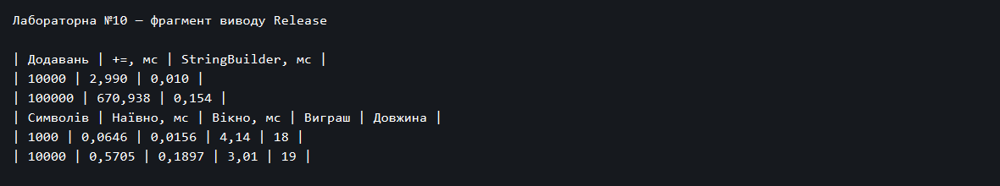

# ЗВІТ ДО ЛАБОРАТОРНОЇ РОБОТИ №10

**Тема:** Обробка рядків і вибір алгоритму за вимірюванням

---

**Варіант:** N = 9, K = 17, a = 0, b = 1, c = 4.

---

Запуск: `dotnet run --file Program.cs -c Release` (.NET 10). Час — мінімум із трьох запусків після прогріву (попередні заміри; рядок для 50 000 символів наведено як попередній результат, вбудований текст містить 49 749 символів).

## 1. Три пастки

| Додавань | +=, мс | StringBuilder, мс |
|---:|---:|---:|
| 10000 | 2,990 | 0,010 |
| 100000 | 670,938 | 0,154 |

Кожне += копіює вже накопичений префікс. StringBuilder записує символи в буфер.

100 000 пар: ToLower — 10,012 мс, OrdinalIgnoreCase — 0,494 мс. Другий спосіб порівнює без створення двох копій слів.

Ordinal (0,0006 мс) — гава, ганок, гніт, гора, гра, гудзик, дуб, дім, кіт, сад, хата, яма, єнот, їжак, ґава, ґазда, ґанок, ґніт, ґрати, ґудзик.

uk-UA (0,0027 мс) — гава, ганок, гніт, гора, гра, гудзик, ґава, ґазда, ґанок, ґніт, ґрати, ґудзик, дім, дуб, єнот, їжак, кіт, сад, хата, яма. Український порядок ставить ґ після г. В Ordinal позицію визначає код UTF-16.

## 2. Найдовший підрядок без повторів

| Символів | Наївно, мс | Вікно, мс | Виграш | Довжина |
|---:|---:|---:|---:|---:|
| 1000 | 0,0646 | 0,0156 | 4,14 | 18 |
| 10000 | 0,5705 | 0,1897 | 3,01 | 19 |
| 50000 | 2,8536 | 0,9926 | 2,87 | 21 |

## 3. Пошук підрядка

| Вхід | Шаблон | Індекс | Порівнянь | Власний, мс | IndexOf, мс |
|---|---|---:|---:|---:|---:|
| проза | Канівщина | 46 | 57 | 0,0001 | 0,0000 |
| проза | електросамокат | -1 | 51821 | 0,0432 | 0,0049 |
| повтори | 1069 × М + Н | -1 | 9556170 | 4,3802 | 0,0006 |

На повторах кожен початок збігається аж до останньої літери шаблону. Бібліотечний пошук може відкидати кандидатів блоками. Його внутрішні порівняння тут не підраховувалися.

## 4. Заявки [початок, кінець)

Оптимум у 100/100 тестах. Найгірше відставання 0%. Раніше завершення залишає щонайменше стільки часу для решти заявок, як будь-який інший перший вибір.

Ранній початок: [0,10), [1,3), [3,5) → 1 замість 2.

Найкоротша заявка: [0,4), [3,5), [4,8) → 1 замість 2.

| Заявок | Перебір, мс | Відсікання, мс | Вузлів без / з відсіканням |
|---:|---:|---:|---:|
| 15 | 0,0008 | 0,0006 | 478 / 280 |
| 20 | 0,0011 | 0,0008 | 805 / 476 |

## 5. Крайові випадки

| Запит | Очікувано | Отримано |
|---|---|---|
| вікно «» | «» | «» |
| вікно «я» | «я» | «я» |
| вікно «ммм» | «м» | «м» |
| вікно «  аб  в » | « аб» | « аб» |
| пошук «а» у «» | -1 | -1 |
| пошук «аб» у «а» | -1 | -1 |
| пошук «» у «аб» | 0 | 0 |
| заявок 0 | 0 | 0 |
| заявок 1 | 1 | 1 |

## 6. Вибір алгоритму

1. Вхід — уривок прози, найбільший замір на 50 000 символів.
2. На кожен із трьох розмірів потрібен один найдовший підрядок. За рівної довжини повертається перший.
3. Текст між запитами сталий, для нового уривка вікно запускається з початку.
4. На повному уривку важливий час: 2,8536 проти 0,9926 мс. Наївний метод повторно перевіряє пари, швидкий зберігає множину символів поточного вікна.
5. HashSet<char> дає додавання й вилучення символу в середньому за сталий час.
6. На 50 000 символів обрано ковзне вікно, виграш 2,87 раза. Короткі серії без повторів у прозі обмежують витрати наївного методу.

## 7. Пояснення

Наївний метод займає 15 рядків, ковзне вікно — 11 (з підписами та дужками). Рання зупинка при повторі скорочує час наївного методу.

Джерело тексту в Program.cs — уривок (49 749 символів) із розділів I–II повісті Івана Нечуя-Левицького «Кайдашева сімя̀», видання 1879 року. [Вікіджерела](https://uk.wikisource.org/wiki/Кайдашева_сімя̀)

## 8. Висновок

Я порівняв алгоритми обробки рядків і вибору інтервалів та визначив найефективніші способи.

