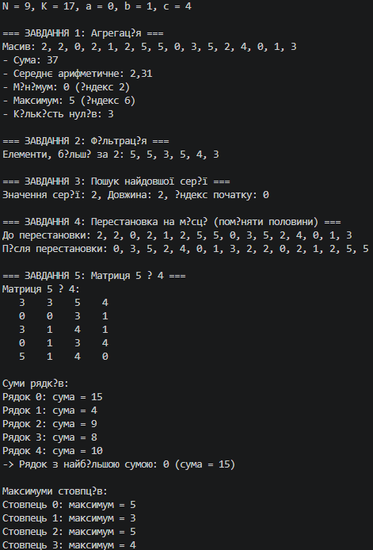

N = 9, K = 17, a = 0, b = 1, c = 4

## Короткий огляд реалізованих методів
- `RunTask1(int[] arr)` — виконання агрегації (сума, середнє, мін/макс з індексами, нулі) за один прохід.
- `RunTask2(int[] arr, int threshold)` — фільтрація елементів (більші за 2) у новий масив точного розміру.
- `RunTask3(int[] arr)` — пошук найдовшої серії однакових елементів (з урахуванням серій на кінці масиву).
- `RunTask4(int[] arr)` — перестановка на місці (обмін першої та другої половин масиву без додаткових масивів).
- `RunTask5(int[,] mat)` — обробка матриці $5 \times 4$ (суми рядків, максимуми стовпців, рядок з найбільшою сумою).

## Таблиця крайових випадків (Завдання 6)

| Вхідні дані | Завдання | Очікувано | Отримано |
| :--- | :---: | :--- | :--- |
| Порожній масив | 1–4 | Повідомлення про неможливість обробки / відсутність даних | Коректне завершення без винятків (Runtime Errors) |
| Одноелементний масив | 1–4 | Мін = Макс = елемент, індекси 0; коректна фільтрація та перестановка | Коректна обробка без збоїв у циклах |
| Усі елементи однакові | 1, 3 | Сума/середнє/мін/макс пораховані; знайдено повну серію завдовжки з увесь масив | Усі агрегати ідентичні значенням, серія визначає всю довжину масиву |

### Коментар щодо виправлень:
Під час тестування на порожньому масиві виникали потенційні ризики звернення до індексу `0`. Проблема була вирішена шляхом додавання захисних умов (`if (arr == null || arr.Length == 0)`) на початку кожного методу, що запобігає аварійному завершенню програми.

