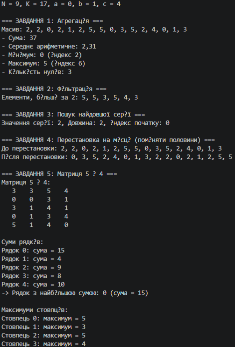

# ЗВІТ ДО ЛАБОРАТОРНОЇ РОБОТИ №3

## 1. Параметри варіанта та реалізовані завдання

* $N = 9$, $K = 17$ (перша літера імені «М» в абетці).

* **Завдання 1 (**$b = 1$**):** Рекурсивний обхід каталогів і обчислення максимальної глибини вкладеності папок.

* **Завдання 2 (**$a = 0$**):** Пошук максимуму в масиві з 16 чисел $[-20; 20]$ шляхом рекурсивного поділу навпіл.

* **Завдання 3 (**$c = 4$**):** Перебір із поверненням (backtracking) — усі способи розміняти 15 грн монетами номіналом 1, 2 та 5 грн.

* **Завдання 4:** Трасування стека викликів для пошуку максимуму.

* **Завдання 5:** Ітеративна реалізація пошуку максимуму циклом та порівняння з рекурсією.

## 2. Базові випадки рекурсивних функцій

1. **Завдання 1 (Обхід каталогів):** Базовим випадком є папка, яка не містить підкаталогів (або папка, до якої відсутні права доступу), внаслідок чого цикл по вкладених директоріях не виконується жодного разу, і функція повертає поточну глибину.

2. **Завдання 2 та 4 (Пошук максимуму навпіл):** Базовим випадком є досягнення меж $\text{lo} == \text{hi}$ (підмасив складається лише з одного елемента), після чого повертається значення цього елемента.

3. **Завдання 3 (Перебір із поверненням):** Базовим випадком є залишок суми $\text{remainingAmount} == 0$ (успішний розміняний варіант виводиться на екран) або вичерпання номіналів монет / вихід за межі меншої за нуль суми.

## 3. Трасування стека викликів (Завдання 4)

Вивід трасування для масиву `{ 7, -2, 15, 4 }`:

```
enter Max(0..3)
  enter Max(0..1)
    enter Max(0..0)
      base case -> 7
    exit  Max(0..0) -> 7
    enter Max(1..1)
      base case -> -2
    exit  Max(1..1) -> -2
  exit  Max(0..1) -> 7
  enter Max(2..3)
    enter Max(2..2)
      base case -> 15
    exit  Max(2..2) -> 15
    enter Max(3..3)
      base case -> 4
    exit  Max(3..3) -> 4
  exit  Max(2..3) -> 15
exit  Max(0..3) -> 15

```

**Пояснення порядку виходів:** Рядки `exit` з'являються у зворотному порядку до `enter`, оскільки виклики функцій утворюють стек (структуру даних LIFO — *Last In, First Out*). Програма занурюється вглиб рекурсії до базових випадків (`enter`), після чого почергово завершує виконання найглибших підзадач знизу вгору, повертаючи результат батьківському виклику (`exit`).

## 4. Відповіді на питання (Завдання 5)

1. **Який запис зрозуміліший для цієї задачі — рекурсивний чи циклічний, і чому?**
   Для задачі пошуку максимуму в лінійному масиві циклічний запис набагато зрозуміліший, простіший у відлагодженні та ефективніший за пам'яттю (використовує $O(1)$ додаткової пам'яті). Рекурсивний поділ навпіл тут є штучним ускладненням, оскільки лінійний перебір циклом (`for`) вирішує цю задачу за один прохід.

2. **Чому так само просто переписати циклом завдання 1 не вийде? Якої саме допоміжної структури даних для цього бракує?**
   Переписати обхід вкладеної ієрархії папок звичайним циклом без рекурсії напряму неможливо, оскільки глибина вкладеності та структура дерева каталогів заздалегідь невідомі. Для заміни системного стека викликів рекурсії циклом вручну доводиться створювати власну допоміжну структуру даних — експліцитний стек (`Stack<string>`) або чергу (`Queue<string>`), в якій самостійно зберігати шлях-об'єкти та стани обходу сусідніх папок.

## 5. Таблиця крайових випадків (Перевірка)

| **Вхідні дані** | **Завдання** | **Очікувано** | **Отримано** | 
| **Порожня папка** | 1 | Глибина вкладеності дорівнює 0 (або коректна обробка без помилок) | Глибина = 0, програма працює стабільно | 
| **Папка без доступу** | 1 | Перехоплення `UnauthorizedAccessException` та пропуск каталогу | Виняток успішно ігнорується, обхід триває | 
| **Масив з одного елемента** | 2 | Повернення цього єдиного елемента як максимуму | Коректне повернення елемента на базовому випадку | 
| **Усі елементи однакові** | 2 | Коректне знаходження цього ж значення | Значення знайдено успішно | 
| **Варіантів не існує** | 3 | Виведення 0 способів без аварійного завершення | Лічильник способів виводить 0 | 

