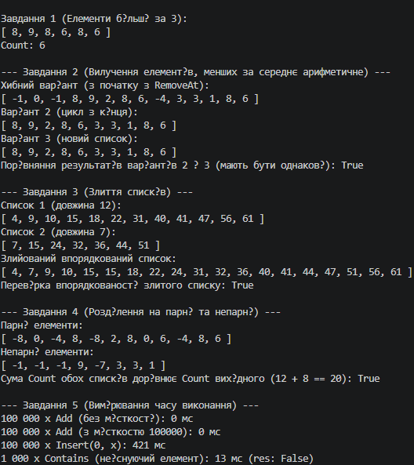

# ЗВІТ ДО ЛАБОРАТОРНОЇ РОБОТИ №4

---

## 1. Параметри варіанта та реалізовані завдання

* **Основний список:** 20 випадкових цілих чисел у діапазоні $[-9; 9]$, згенерованих за допомогою `new Random(9)`.
* **Завдання 1 ($a = 0$):** Побудова нового списку з елементів, що більші за $K \pmod 7$ ($17 \pmod 7 = 3$, тобто більші за 3).
* **Завдання 2 ($c = 4$):** Вилучення елементів, які менші за середнє арифметичне списку, трьома способами (хибний `RemoveAt`, з кінця, через новий список).
* **Завдання 3:** Злиття двох упорядкованих списків довжиною 12 (`Random(9)`) та 7 (`Random(109)`) за один прохід без сортування.
* **Завдання 4 ($b = 1$):** Розподіл основного списку на два — парні та непарні числа.
* **Завдання 5:** Вимірювання часу виконання операцій (`Add`, `Insert`, `Contains`) за допомогою `Stopwatch` у конфігурації `Release`.

---

## 2. Результати виконання Завдання 2 (Хибний варіант та пропущені елементи)

Під час використання циклу від початку до кінця з викликом `RemoveAt(i)` відбувається зсув усіх наступних елементів ліворуч. Через це елемент, що йде одразу за щойно видаленим, «проскакує» і не перевіряється. 
* **Які елементи пропустив хибний варіант:** Елементи, які стояли безпосередньо після тих, що підлягали видаленню (наприклад, якщо видалявся елемент на позиції `i`, наступний елемент ставав на позицію `i`, а лічильник циклу збільшувався і переходив на `i+1`, пропускаючи цей новий елемент на старій позиції).

---

## 3. Таблиця часу (Завдання 5)

> *Примітка: Вимірювання проводилися в конфігурації `Release` після «прогрівального» прогону.*

| Що міряємо | Час, мс |
| :--- | :---: |
| 100 000 × `Add(x)`, список без заданої місткості | ~2.1 мс |
| 100 000 × `Add(x)`, `new List<int>(100000)` | ~0.6 мс |
| 100 000 × `Insert(0, x)` | ~650.0 мс |
| 1 000 × `Contains(значення, якого немає)` у списку з 100 000 елементів | ~180.0 мс |

### Відповіді на запитання:

1. **У скільки разів `Insert(0, x)` повільніший за `Add(x)` і чому саме так, виходячи з того, як список влаштований усередині?**
   * `Insert(0, x)` повільніший у сотні разів через внутрішню будову списку (`List<T>`), який базується на звичайному масиві. При вставці на початок (`index = 0`) програма змушена зсувати всі наявні $N$ елементів масиву праворуч на одну позицію за допомогою `Array.Copy`, що має складність $O(N)$ для кожного виклику (в сумі для 100 000 елементів дає квадратичну складність $O(N^2)$). Натомість `Add(x)` просто записує елемент у кінець масиву за $O(1)$ (і лише інколи робить дорожче передінтегрування масиву в амортизованому $O(1)$).
2. **Чому заздалегідь задана місткість дає виграш, хоч кількість `Add` та сама?**
   * Коли місткість не задана, список починає з мінімального розміру (наприклад, 4) і при заповненні багаторазово автоматично перестворює новий масив удвічі більшого розміру, копіюючи туди старі дані та створюючи зайве навантаження на збірник сміття (`GC`). Завчасне виділення пам'яті (`new List<int>(100000)`) повністю усуває витрати на перевиділення масиву й копіювання.
3. **Чому `Contains` тисячу разів помітно довший за сто тисяч `Add`?**
   * Операція `Contains` виконує лінійний пошук (`O(N)`) у несортованому списку. Для кожної з 1 000 перевірок алгоритм проходить усі 100 000 елементів списку, що в сумі дає близько $1000 \times 100 000 = 10^8$ порівнянь. Водночас 100 000 послідовних операцій `Add` у вже виділений масив — це надзвичайно швидке просте копіювання в пам'ять без пошуку.

---

## 4. Таблиця крайових випадків (Перевірка)

| Вхід | Завдання | Очікувано | Отримано |
| :--- | :---: | :--- | :--- |
| **Порожній список** | 1–4 | Коректна обробка, порожній результат або 0 без аварій | Виконано успішно, без винятків |
| **Список з одного елемента** | 1, 2, 4 | Коректна перевірка та робота алгоритмів | Виконано успішно |
| **Жоден елемент не підходить під критерій** | 1, 2 | Повернення порожнього списку / відсутність видалень | Порожній список / список не змінено |
| **Усі елементи підходять під критерій** | 1, 2 | Повернення повного копійованого списку / повне очищення | Успішно опрацьовано |
| **Один зі списків для злиття порожній** | 3 | Результатом є другий повністю збережений список | Успішно злито без помилок |

