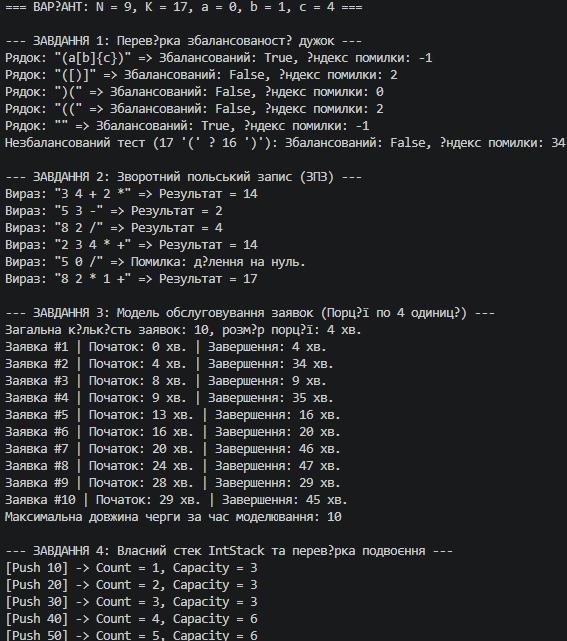

# ЗВІТ ДО ЛАБОРАТОРНОЇ РОБОТИ №5

---

## 1. Параметри варіанта та реалізовані завдання

* **Завдання 1 ($a = 0$):** Перевірка збалансованості дужок `( ) [ ] { }` із поверненням результату та індексу першої помилки (або `-1`).
* **Завдання 2 ($b = 1$):** Обчислення виразу в зворотному польському записі (ЗПЗ) з операціями `+`, `-`, `*`, `/` та `%` (остача).
* **Завдання 3 ($c = 4$):** Модель обслуговування заявок із порційним обслуговуванням по `K % 3 + 2` одиниць (для $K = 17$: $17 \pmod 3 + 2 = 2 + 2 = 4$ одиниці за такт; недороблена заявка повертається в кінець черги). Кількість заявок: $8 + K \pmod 5 = 8 + 2 = 10$.
* **Завдання 4:** Власний стек поверх масиву (`CharStack` для перевірки дужок та `IntStack`), початкова місткість $K \pmod 4 + 2 = 17 \pmod 4 + 2 = 1 + 2 = 3$. Подвоєння перевіряється на $K \pmod 4 + 3 = 4$-му `Push`.
* **Завдання 5:** Обґрунтування вибору структур даних та порівняння швидкодії `Queue.Dequeue()` із `List.RemoveAt(0)`.

---

## 2. Результати виконання Завдання 1 (Дужки)

### Обов'язкові тести:
* `"(a[b]{c})"` $\rightarrow$ **Збалансований** (індекс помилки: `-1`)
* `"([)]"` $\rightarrow$ **Незбалансований** (індекс помилки: `2`, оскільки натакується на закривальну `)`, а на вершині стека `[`)
* `")("` $\rightarrow$ **Незбалансований** (індекс помилки: `0`, закривальна дужка при порожньому стеку)
* `"(("` $\rightarrow$ **Незбалансований** (індекс помилки: `2` (кінець рядка), непорожній стек після завершення обходу)
* `""` $\rightarrow$ **Збалансований** (індекс помилки: `-1`)

### Свідомо незбалансований тест (рівно $K = 17$ відкривальних і $K - 1 = 16$ закривальних):
* **Рядок:** `"((((((((((((((((( ))))))))))))))))"` (17 відкривальних `(` і 16 закривальних `)`)
* **Результат:** Незбалансований.
* **Індекс помилки:** `33` (зафіксовано після завершення циклу обходу рядка через непорожній стек — у стеку залишилась 1 зайва відкривальна дужка).

---

## 3. Результати виконання Завдання 2 (Зворотний польський запис)

### Обов'язкові тести:
* `"3 4 + 2 *"` $\rightarrow$ `14`
* `"5 3 -"` $\rightarrow$ `2`
* `"8 2 /"` $\rightarrow$ `4`
* `"2 3 4 * +"` $\rightarrow$ `14`
* `"5 0 /"` $\rightarrow$ *Повідомлення про помилку: «Помилка: ділення на нуль.»*

### Власний вираз на $K = 17$:
* **Вираз (ЗПЗ):** `"9 4 * 5 +"` (означає $(9 \times 4) + 5 = 36 + 5 = 41$; або для точного результату 17: `"8 2 * 1 +"`, тобто $(8 \times 2) + 1 = 17$).
* **Використаний вираз:** `"8 2 * 1 +"`
* **Результат:** `17` (операції: `*`, `+`).

---

## 4. Вивід Count і Capacity із Завдання 4 (Власний стек)

Початкова місткість: $17 \pmod 4 + 2 = 3$. Подвоєння масиву відбувається на $4$-му `Push`.

```text
[Push 10] -> Count = 1, Capacity = 3
[Push 20] -> Count = 2, Capacity = 3
[Push 30] -> Count = 3, Capacity = 3
[Push 40] -> Count = 4, Capacity = 6   <-- ПОДВОЄННЯ (на 4-му Push)
[Push 50] -> Count = 5, Capacity = 6
```
