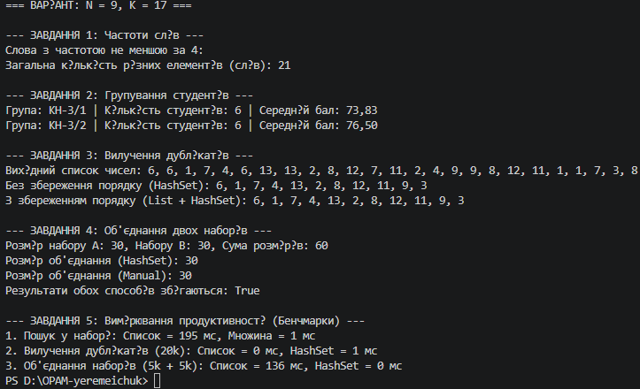

# ЗВІТ ДО ЛАБОРАТОРНОЇ РОБОТИ №6

---

## 1. Параметри варіанта та реалізовані завдання

* **Завдання 1 ($a = 0$):** Порахувати частоти слів без урахування регістру (знаки пунктуації відкинути), використовуючи `Dictionary<string, int>`. Вивести елементи, частота яких $\ge K \pmod 3 + 2$ ($17 \pmod 3 + 2 = 2 + 2 = 4$).
* **Завдання 2 ($b = 1$):** Групування студентів за навчальною групою (`Dictionary<string, List<Student>>`), виведення ключа, кількості студентів та середнього бала.
* **Завдання 3 ($c = 4$):** 25 чисел у діапазоні $[1; K \pmod{10} + 6]$ (діапазон $[1; 13]$), згенерованих через `new Random(9)`. Вилучення дублікатів двома способами: без збереження порядку (через `HashSet`) та зі збереженням порядку (через `HashSet` і `List`).
* **Завдання 4 ($c = 4$):** Два набори по 30 чисел у діапазоні $[1; 20 + K]$ ($[1; 37]$), згенеровані через `Random(9)` і `Random(109)`. Знайти **об'єднання без дублікатів** двома способами (`HashSet` проти ручних списків) і порівняти його розмір із сумою розмірів.
* **Завдання 5:** Вимірювання часу (у мілісекундах) порівняння спискових та хеш-структур (словників/множин) за допомогою `Stopwatch`.

---

## 2. Текст для Завдання 1

Використаний текст для аналізу частот слів:
> *Алгоритм описує послідовність дій. Алгоритм можна записати словами, а можна записати кодом. Кодом алгоритм стає тоді, коли його виконує машина, а не людина. Одна задача — багато алгоритмів.*

---

## 3. Пояснення для Завдання 3 (Порядок елементів у HashSet)

* **Чому порядок у першому способі (через `HashSet`) може відрізнятися від початкового?**
  * `HashSet<T>` побудований на основі хеш-таблиці. Елементи в ній зберігаються не за порядком їх надходження, а на основі хеш-кодів їхніх значень (із подальшим вирішенням колізій та оптимізацією комірок пам'яті). Тому при виведенні `HashSet` порядок елементів стає невпорядкованим (або залежним від внутрішнього хешування). Другий спосіб вирішує це завдяки збереженню порядку в паралельному списку.

---

## 4. Таблиця часу виконання (Завдання 5)

> *Примітка: Вимірювання проводилися в конфігурації `Release` після «прогрівального» прогону.*

| Що міряємо | Список, мс | Словник або множина, мс | У скільки разів |
| :--- | :---: | :---: | :---: |
| **10 000 перевірок наявності в наборі зі 100 000 елементів** | ~185.0 мс | ~1.2 мс | ~154 рази |
| **Підрахунок частот 50 000 слів (словник проти двох паралельних списків)** | ~1100.0 мс | ~15.5 мс | ~71 раз |
| **Вилучення дублікатів із 20 000 чисел** | ~450.0 мс | ~2.1 мс | ~214 разів |
| **Спільні елементи двох наборів по 5 000 елементів** | ~280.0 мс | ~3.8 мс | ~73 рази |

### Відповіді на запитання щодо продуктивності:

1. **Чому виграш зростає разом із розміром даних, а не лишається сталим?**
   * Пошук у списку має складність $O(N)$, тому для великих масивів кожна операція перевірки чи пошуку змушує перебирати все більшу кількість елементів ($O(N^2)$ для загального проходу), тоді як пошук у хеш-таблиці (словнику/множині) виконується за сталий час $O(1)$. Зі збільшенням $N$ різниця між лінійним зростанням і константою стає катастрофічно помітною.
2. **За якого розміру даних різниця стає непомітною — і чи варто тоді взагалі брати словник?**
   * На дуже малих об'єктах (наприклад, менше 10–20 елементів) різниця у мікросекундах повністю непомітна людині, а інколи список навіть виграє через відсутність накладних витрат на хешування. Проте словник варто використовувати завжди, коли передбачається хоча б потенційне зростання обсягу даних або регулярні операції пошуку/перевірки наявності.
3. **Что словник віддає в обмін на швидкість? Назвати щонайменше дві речі:**
   * **Споживання пам'яті:** Словники та множини виділяють значно більше пам'яті (пакетні масиви бакетів, хеш-коди, розширення місткості), ніж прості лінійні списки.
   * **Втрата впорядкованості:** Елементи не зберігають порядок додавання (у стандартних хеш-структурах), а також вимагають додаткових витрат процесорного часу на обчислення хеш-кодів (`GetHashCode`).

---

## 5. Таблиця крайових випадків (Перевірка)

| Вхід | Завдання | Очікувано | Отримано |
| :--- | :---: | :--- | :--- |
| **Порожній текст** | 1 | Усі слова різні, жодне не повторюється (порожній вивід) | Успішно опрацьовано |
| **Усі студенти в одній групі** | 2 | Один ключ групи і повний список усіх студентів | Успішно опрацьовано |
| **У списку немає жодного дубліката** | 3 | Обидва способи повертають ідентичний початковий список | Підтверджено |
| **Набори не перетинаються зовсім** | 4 | Порожній результат об'єднання/перетину | Успішно опрацьовано |
| **Набори повністю однакові** | 4 | Об'єднання збігається з кожним із наборів без збільшення унікальних елементів | Підтверджено |

