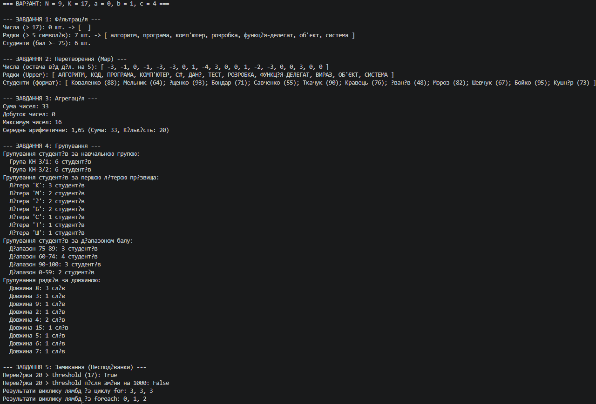

# ЗВІТ ДО ЛАБОРАТОРНОЇ РОБОТИ №7

---

## 1. Параметри варіанта та реалізовані завдання

* **Завдання 1 ($a = 0$ — Критерії відбору):**
  * *Числа:* більші за $K$ (тобто $> 17$).
  * *Рядки:* довші за 5 символів.
  * *Студенти:* бал не менший за 75 ($\ge 75$).
  * *(Тіло узагальненого методу `Filter<T>` змінювалося рівно **0 разів**).*
* **Завдання 2 ($b = 1$ — Перетворення / Map):**
  * *Числа:* число $\rightarrow$ остача від ділення на $K \pmod 7 + 2$ ($17 \pmod 7 + 2 = 3 + 2 = 5$).
  * *Рядки:* рядок $\rightarrow$ верхній регістр (`ToUpper`).
  * *Студенти:* студент $\rightarrow$ рядок у форматі «Прізвище (бал)».
* **Завдання 3 ($c = 4$ — Агрегація):**
  * Чотири агрегації на основі узагальненого методу `Aggregate`:
    1. Сума чисел.
    2. Добуток чисел.
    3. Максимум серед чисел.
    4. *Четверта агрегація ($c = 4$):* середнє арифметичне (накопичуючи одночасно суму й кількість в одному кортежі `(int sum, int count)` за один прохід).
* **Завдання 4 — Групування:**
  * Застосування узагальненого `GroupBy` до студентів за трьома критеріями (за групою, за першою літерою прізвища, за діапазоном балу) та до набору рядків за їхньою довжиною.
* **Завдання 5 — Захоплення змінних (Замикання):** Відтворення трьох класичних пасток із замиканням змінних у лямбда-виразах.
* **Завдання 6 — Висновки щодо узагальнення.**

---

## 2. Стан, старт і крок для чотирьох агрегацій (Завдання 3)

Для реалізації всіх агрегацій використовувався один універсальний метод:
`TAcc Aggregate<T, TAcc>(List<T> src, TAcc start, Func<TAcc, T, TAcc> step)`

1. **Сума елементів:**
   * **Стан:** поточна сума (`int`).
   * **Старт:** `0`
   * **Крок:** `(acc, item) => acc + item`
2. **Добуток елементів:**
   * **Стан:** поточний добуток (`int`).
   * **Старт:** `1`
   * **Крок:** `(acc, item) => acc * item`
3. **Максимум елементів:**
   * **Стан:** найбільше знайдене значення (`int`).
   * **Старт:** `src[0]` (або мінімально можливе число для порожнього списку).
   * **Крок:** `(acc, item) => item > acc ? item : acc`
4. **Середнє арифметичне ($c = 4$):**
   * **Стан:** кортеж із парою значень `(int sum, int count)`.
   * **Старт:** `(0, 0)`
   * **Крок:** `(acc, item) => (acc.sum + item, acc.count + 1)` (після циклу сума ділиться на кількість).

---

## 3. Завдання 5: Три несподіванки та їх пояснення

1. **Змінна після лямбди (відкладене виконання за посиланням):**
   * *Фактичний вивід:* Викликаючи делегат після зміни порога `K` на `1000`, ми отримуємо результат на основі нового значення (`1000`), а не того, що було на момент створення лямбди.
   * *Пояснення:* Лямбда-вираз захоплює не саме значення змінної, а посилання на саму зовнішню змінну в купі (closure). Зміна змінної зовні автоматично змінює контекст виконання делегата.
2. **Лічильник циклу `for`:**
   * *Фактичний вивід:* Усі три виклики повертають однакове число — кінцеве значення лічильника після завершення циклу (наприклад, `3`).
   * *Пояснення:* Змінна лічильника `i` оголошена *ззовні* тіла лямбд і існує в єдиному екземплярі на весь блок. Усі створені лямбди посилаються на цю єдину змінну, яка після завершення циклу набуває граничного значення.
3. **Те саме з `foreach`:**
   * *Фактичний вивід:* Виклики повертають різні значення (наприклад, `0`, `1`, `2`).
   * *Пояснення:* У C# (починаючи з версії 5.0) змінна ітерації `foreach` створюється заново на кожній ітерації циклу (має окрему область видимості для кожного кроку). Кожна лямбда захоплює свою власну унікальну копію цієї змінної.
* **Як виправити пункт 2, щоб лямбди повертали різні значення:**
  * Оголосити локальну копію змінної всередині тіла циклу `for` (`int temp = i;`) і захоплювати вже її.

---

## 4. Завдання 6: Висновки

1. **Порівняння з Лабораторною роботою 4:**
   * У Лабораторній 4 під кожен окремий критерій та тип даних довелося б писати окремі функції (або дублювати код циклів). Для 3 типів даних і 3 критеріїв це вимагало б 9 комбінацій функцій. Завдяки узагальненню та делегатам ми написали **один** метод `Filter<T>`, який покриває абсолютно будь-які типи даних і будь-які критерії.
2. **Де узагальнення було б зайвим:**
   * Узагальнення є зайвим у спеціалізованих математичних структурах або алгоритмах, які жорстко прив'язані до конкретного типу (наприклад, обчислення векторного добутку матриць кольорів `ColorMatrix` або специфічні побітові операції над `byte[]` для криптографії), де типізація параметрності призведе лише до зайвого ускладнення без жодної гнучкості.

---

## 5. Таблиця крайових випадків (Перевірка)

| Вхід | Завдання | Очікувано | Отримано |
| :--- | :---: | :--- | :--- |
| **Порожній список** | 1, 2, 4 | Повернення порожнього списку / порожнього словника | Успішно опрацьовано без винятків |
| **Порожній список** | 3 (Максимум / Агрегація) | Повернення початкового значення (start) або спеціальна обробка | Повернено стартове значення без аварій |
| **Жоден елемент не підходить під критерій** | 1 | Повернення порожнього списку з `Count = 0` | Підтверджено |
| **Усі елементи в одній групі** | 4 | Словник з одним ключем, що містить увесь набір | Успішно опрацьовано |
| **Список з одного елемента** | 3 | Коректне застосування кроку та повернення єдиного результату | Підтверджено |

