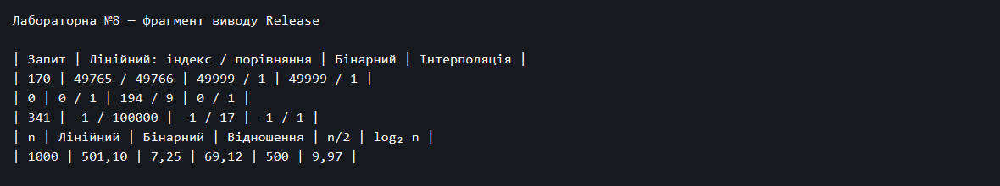

# ЗВІТ ДО ЛАБОРАТОРНОЇ РОБОТИ №8

**Тема:** Алгоритми пошуку та їх порівняння

---

**Варіант:** N = 9, K = 17, a = 0, b = 1, c = 4.

---

Запуск: `dotnet run -c Release` (.NET 10). Час — мінімум із трьох запусків після прогріву (попередні заміри).

## 1. Пошук на 100 000 чисел

| Запит | Лінійний: індекс / порівняння | Бінарний | Інтерполяція |
|---|---|---|---|
| 170 | 49765 / 49766 | 49999 / 1 | 49999 / 1 |
| 0 | 0 / 1 | 194 / 9 | 0 / 1 |
| 341 | -1 / 100000 | -1 / 17 | -1 / 1 |

## 2. Чотири поломки

1. [1], шукаємо 1. Умова lo < hi пропускає єдину позицію, результат -1.
2. [1, 2], шукаємо 2. Присвоєння lo = mid залишає межі на місці: після 20 кроків lo=0, hi=1.
3. Для довжини 1 073 741 825 останній індекс 1 073 741 824. Коли обидві межі дійдуть до нього, (lo + hi) / 2 дає -1073741824. Для 100 000 сума індексів щонайбільше 199 998.
4. Без сортування пропущено 99 зі 100 наявних запитів.

## 3. Межі

Блок [ 49765, 50034 ). Останній індекс 50033 за 16 порівнянь; кількість 269 за 33. Контроль повним обходом — 100000 порівнянь для обох відповідей. На кожній ітерації лишається половина ділянки незалежно від кількості повторів.
Умова кратності 7 чергує істину й хибу. Метод дав 100000, перша правильна позиція 0 (значення 0).

## 4. Середні порівняння для 100 запитів

| n | Лінійний | Бінарний | Відношення | n/2 | log₂ n |
|---:|---:|---:|---:|---:|---:|
| 1000 | 501,10 | 7,25 | 69,12 | 500 | 9,97 |
| 10000 | 5049,98 | 7,72 | 654,14 | 5000 | 13,29 |
| 100000 | 50591,76 | 7,64 | 6621,96 | 50000 | 16,61 |
| 1000000 | 506127,09 | 7,73 | 65475,69 | 500000 | 19,93 |

## 5. Окупність сортування

| q | Перебір, мс | Сортування + пошук, мс | Швидший |
|---:|---:|---:|---|
| 1 | 0,0000 | 2,7525 | перебір |
| 5 | 0,0001 | 2,7735 | перебір |
| 10 | 0,0001 | 2,9084 | перебір |
| 20 | 0,0003 | 2,7503 | перебір |
| 30 | 0,0008 | 2,7565 | перебір |
| 50 | 0,0020 | 2,7662 | перебір |
| 100 | 0,0076 | 2,7535 | перебір |
| 200 | 0,0270 | 2,7587 | перебір |
| 400 | 0,0904 | 2,7834 | перебір |
| 800 | 0,2693 | 2,8498 | перебір |
| 1600 | 0,6957 | 2,8332 | перебір |
| 3200 | 1,6603 | 2,8795 | перебір |
| 6400 | 3,4043 | 3,1564 | бінарний із сортуванням |

Перша виміряна перемога сортування: 6400. Оцінка 34 припускає довгий перебір. Тут лише 341 можливий ключ, тому на випадковому невпорядкованому вході копія ключа зазвичай трапляється значно раніше за середину.

## 6. Крайові випадки

| Масив, запит | Очікувані індекс / межі | Отримано |
|---|---|---|
| [], 1 | -1 / 0, 0 | -1 / 0, 0 |
| [1], 1 | 0 / 0, 1 | 0 / 0, 1 |
| [1,2], 2 | 1 / 1, 2 | 1 / 1, 2 |
| [2,3], 1 | -1 / 0, 0 | -1 / 0, 0 |
| [2,3], 4 | -1 / 2, 2 | -1 / 2, 2 |
| [2,2,2], 2 | 1 / 0, 3 | 1 / 0, 3 |

## 7. Пояснення

Якщо ключа немає, лінійний пошук перевіряє весь масив. Інтерполяційний пошук добре працює на рівномірних даних; інакше після першої проби використовується бінарний пошук.

Для діапазонів зручно використовувати відсортований масив. Для перевірки наявності — `HashSet`, для частот — `Dictionary`.

## 8. Висновок

Я реалізував три алгоритми пошуку та порівняв їхню ефективність.

