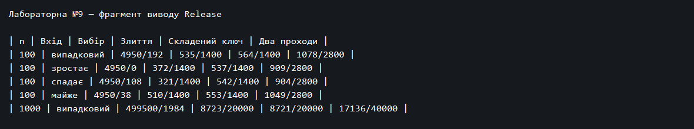

# ЗВІТ ДО ЛАБОРАТОРНОЇ РОБОТИ №9

**Тема:** Реалізація та порівняння алгоритмів сортування

---

## 1. Параметри варіанта та реалізовані завдання

* **N = 9, K = 17, a = 0, b = 1, c = 4.**
* **Завдання 1:** Сортування вибором і злиттям з підрахунком порівнянь та записів.
* **Завдання 2:** Трасування сортування вибором на восьми числах.
* **Завдання 3:** Перевірка випадкового, впорядкованого, зворотного та майже впорядкованого входу.
* **Завдання 4:** Сортування студентів за двома ключами, перевірка стабільності й порівняння часу.
* **Завдання 5:** Перевірка порядку та збереження складу масиву.

---

Запуск із папки роботи: `dotnet run -c Release` (.NET 10). Для замірів використано `Stopwatch`, попередній прогрів і мінімум трьох запусків. Числа в таблицях і знімок екрана збережено з попереднього звіту; під час повторного запуску час може відрізнятися.

---

## 2. Трасування
Початок → 145, 156, 20, 163, 91, 144, 320, 326

→ 20, 156, 145, 163, 91, 144, 320, 326

→ 20, 91, 145, 163, 156, 144, 320, 326

→ 20, 91, 144, 163, 156, 145, 320, 326

→ 20, 91, 144, 145, 156, 163, 320, 326

→ 20, 91, 144, 145, 156, 163, 320, 326

→ 20, 91, 144, 145, 156, 163, 320, 326

→ 20, 91, 144, 145, 156, 163, 320, 326

---

## 3. Порівняння / записи (включно з буфером)

| n | Вхід | Вибір | Злиття | Складений ключ | Два проходи |
|---:|---|---:|---:|---:|---:|
| 100 | випадковий | 4950/192 | 535/1400 | 564/1400 | 1078/2800 |
| 100 | зростає | 4950/0 | 372/1400 | 537/1400 | 909/2800 |
| 100 | спадає | 4950/108 | 321/1400 | 542/1400 | 904/2800 |
| 100 | майже | 4950/38 | 510/1400 | 553/1400 | 1049/2800 |
| 1000 | випадковий | 499500/1984 | 8723/20000 | 8721/20000 | 17136/40000 |
| 1000 | зростає | 499500/0 | 5052/20000 | 7804/20000 | 12856/40000 |
| 1000 | спадає | 499500/1362 | 5382/20000 | 7984/20000 | 13812/40000 |
| 1000 | майже | 499500/68 | 6682/20000 | 7957/20000 | 14435/40000 |
| 10000 | випадковий | 49995000/19940 | 123619/280000 | 123652/280000 | 241218/560000 |
| 10000 | зростає | 49995000/0 | 71712/280000 | 99271/280000 | 170983/560000 |
| 10000 | спадає | 49995000/13988 | 73814/280000 | 103863/280000 | 179066/560000 |
| 10000 | майже | 49995000/422 | 90332/280000 | 101738/280000 | 189084/560000 |

---

## 4. Час у мс (мінімум із трьох після прогріву)

| n | Вибір | Злиття | Два ключі (один / два проходи) | Array.Sort |
|---:|---:|---:|---:|---:|
| 1000 | 0,989 | 0,041 | 0,070 / 0,134 | 0,007 |
| 10000 | 93,280 | 0,636 | 1,276 / 2,094 | 0,266 |
| 100000 | 9403,419 | 7,839 | 21,614 / 41,436 | 2,761 |
| 1000000 | — | 84,265 | 587,470 / 1263,906 | 27,872 |

Перший перевірений розмір понад секунду (крок 5000) — 35000, 1204,5 мс.

---

## 5. Стабільність за балом

| Метод | Очікувано | Фактично на вибірці | Перша інверсія прізвищ |
|---|---|---|---|
| Вибір | нестабільний | порушено | Студент0000021 → Студент0000002 |
| Злиття | стабільний | збережено | — |
| Array.Sort | нестабільний | порушено | Студент0000114 → Студент0000113 |
| OrderBy | стабільний | збережено | — |

---

## 6. Крайові випадки

| Вхід | Очікувано | Отримано |
|---|---|---|
| [] | порядок і склад збережені | пройдено |
| [1] | порядок і склад збережені | пройдено |
| [1,2] | порядок і склад збережені | пройдено |
| [2,1] | порядок і склад збережені | пройдено |
| [3,3,3] | порядок і склад збережені | пройдено |
| [2,2,1,1] | порядок і склад збережені | пройдено |

На випадковому вході з 10 000 чисел вибір зробив у 404,43 раза більше порівнянь. Лекційні 376 спираються на n log₂ n, а тут пораховані фактичні виклики компаратора.

---

## 7. Пояснення

Вибір завжди виконує n(n−1)/2 порівнянь, проте на впорядкованому вході обходиться без записів. Злиття проходить ті самі рівні на кожному вході, а кількість порівнянь змінюється залежно від того, як швидко вичерпується одна половина.

Для двох ключів збіг підтверджено для всіх 12 входів. Стабільне злиття спочатку за балом, потім за групою зберігає порядок балів у кожній групі. Одне складене порівняння задає той самий порядок. Час цих двох методів включає роботу із записами Student, решта часових колонок стосується чисел.

Array.Sort для чисел працює на місці й уникає повного копіювання масиву на кожному рівні. Для коротких ділянок його інтроспективне сортування переходить до вставок. Для щоденного стабільного сортування 100 000 записів з ключами 0–300 підійде сортування підрахунком із масивом виходу: префіксні суми дають початкові позиції, послідовний запис зберігає порядок рівних ключів.

---

## 8. Висновок

Я реалізував сортування вибором і злиттям та порівняв їхню швидкодію. Перевірив збереження елементів, порядок і стабільність сортування. З’ясував, чому злиття краще підходить для великих масивів.

